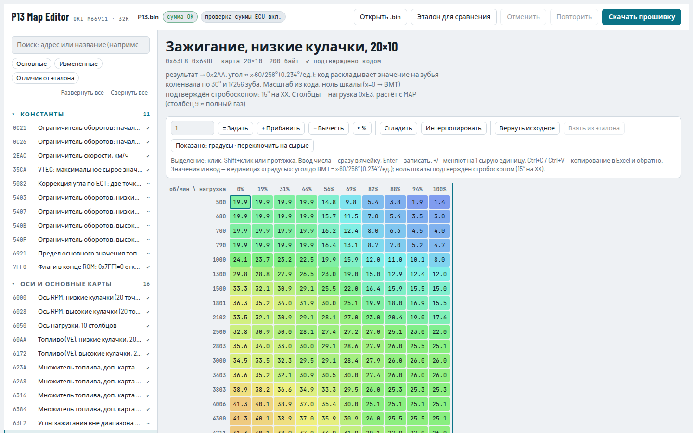
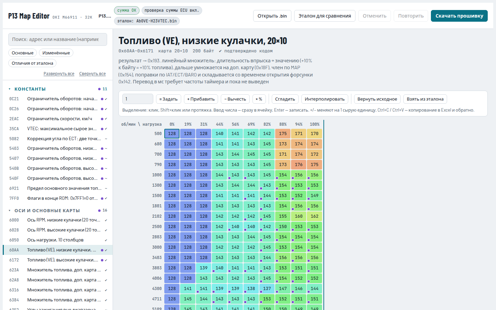
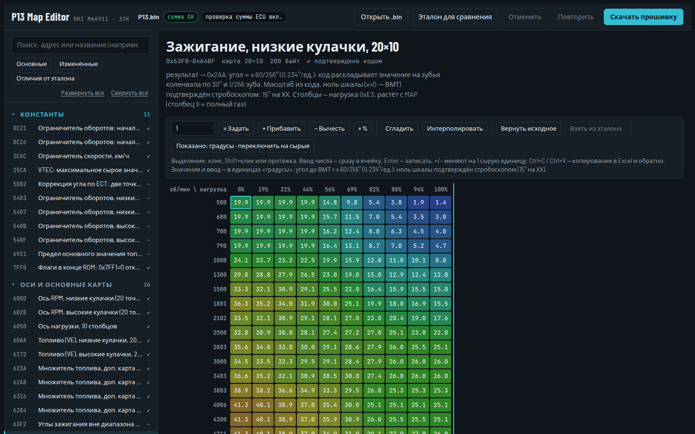

# P13 Map Editor

Браузерный редактор карт для ЭБУ **Honda Prelude P13** (H22A, OKI M66911, 32 КБ ROM).
Откройте образ `.bin`, поправьте карты топлива и зажигания, VTEC и ограничители — и скачайте прошивку с уже исправленной контрольной суммой.

**▶ [Открыть редактор](https://icelord75.github.io/p13-map-editor/)** — ничего не нужно устанавливать, файл прошивки никуда не отправляется и обрабатывается прямо в браузере.

## Возможности

- **Каталог таблиц с понятными названиями.** Основные карты топлива и зажигания (низкие и высокие кулачки), оси RPM и нагрузки, VTEC, ограничители оборотов и скорости, коррекции по ECT/IAT/MAP/напряжению. Таблицы сгруппированы, группы сворачиваются, есть поиск по адресу и названию.
- **Значения в физических единицах:** градусы опережения, множители топлива, обороты, °C, км/ч, мс. Нагрузка по столбцам показана в процентах. Переключатель «сырые / физические» — в один клик.
- **Тепловая раскраска и графики** для карт и одномерных таблиц.
- **Групповые правки:** задать, прибавить, вычесть, умножить на %, сгладить, интерполировать выделенную область; копирование в Excel и вставка из него (Ctrl+C / Ctrl+V).
- **Сравнение с эталоном.** Загрузите вторую прошивку (сток или чужой тюн): отличающиеся ячейки отмечаются, их можно перенести одной кнопкой; фильтр «Отличия от эталона» показывает затронутые таблицы.
- **Отмена и повтор** (Ctrl+Z / Ctrl+Shift+Z), список всех изменений с переходом к ячейке.
- **Контрольная сумма.** ЭБУ требует, чтобы сумма всех байт ROM была равна 0; при скачивании редактор подгоняет байт-компенсатор `0x3A`. Флаг проверки суммы (`0x7FF1`) тоже доступен.
- **Пометки МКПП / АКПП.** Парные таблицы подписаны по коробке: какая из пары используется, задают перемычки RP11/RP12 на плате.
- **Произвольный адрес** — шестнадцатеричный редактор для всего, чего нет в каталоге.
- Светлая и тёмная тема, работа на телефоне, работа офлайн.

 

## Как пользоваться

1. Откройте [редактор](https://icelord75.github.io/p13-map-editor/) и перетащите в окно образ ROM (32 768 байт).
2. Редактор проверит размер и сигнатуры P13 и покажет состояние контрольной суммы.
3. Выберите таблицу слева, выделите ячейки (клик, Shift+клик или протяжка) и введите значение или примените операцию.
4. Нажмите **«Скачать прошивку»** — получите `<имя>_edit.bin` с исправленной суммой.

Работает и без интернета: скачайте [`index.html`](index.html) и откройте его в браузере. Всё — один файл без зависимостей (шрифты подгружаются из Google Fonts, без сети используются системные).

## Единицы и формулы

| Величина | Перевод | Статус |
|---|---|---|
| Угол зажигания | ° до ВМТ = x · 60/256 (0.234°/ед.) | подтверждено кодом и стробоскопом (15° на ХХ) |
| Топливные карты | множитель; +10 % к байту = +10 % длительности впрыска | подтверждено кодом |
| Доп. топливные карты | x/128, 128 = ×1.00 | подтверждено кодом |
| Обороты | RPM = 1 875 000 / период; RPM-байт: 0→500, 64→1000, 128→2000, 192→4000 | подтверждено кодом |
| MAP / BARO | P ≈ (x − 8) / 2.42 кПа | по сервисному мануалу |
| ECT / IAT | термистор по мануалу + подтяжка ≈ 1.65 кОм | оценка, ±5–10 °C |
| Время впрыска | мс = x · 0.004 (тик 4 мкс при кварце 16 МГц) | оценка |

Подробное описание всех карт, переменных RAM, формул и аппаратной части — в [`docs/P13_maps.md`](docs/P13_maps.md).
Файл символов для дизассемблера — [`docs/P13.sym`](docs/P13.sym) (формат `dasm -s` из [oki66k-tools](https://github.com/icelord75/oki66k-tools)).

## Совместимость

Адреса таблиц одинаковы для всех изученных прошивок P13: сток JDM и USDM, а также распространённые тюны (17 образцов). Прошивки других ЭБУ Honda (P28, P30, P72 и т. п.) имеют другую раскладку и **не поддерживаются**: редактор проверяет сигнатуры кода и не откроет чужой образ.

Таблицы, назначение которых пока не установлено, в списке скрыты; их можно править через «Произвольный адрес».

## Предупреждение

Это инструмент для исследований и тюнинга на свой страх и риск. Неверные значения топлива и зажигания могут повредить двигатель. Всегда сохраняйте оригинальный образ, проверяйте изменения на стенде или с широкополосным лямбда-зондом и не превышайте разумных углов опережения.

## Ссылки

- [oki66k-tools](https://github.com/icelord75/oki66k-tools) — ассемблер и дизассемблер для OKI 66K, которыми получен и проверен разбор прошивки.
- [hondabase.com — P13](https://www.hondabase.com/cars/sensors/p13) — распиновка и датчики ЭБУ.

---

## English summary

**P13 Map Editor** is a single-page, in-browser editor for the Honda Prelude **P13** ECU ROM (H22A, OKI M66911, 32 KB).
Load a `.bin`, edit fuel and ignition maps, VTEC and limiter settings, rev and speed limits, and download the result with the checksum fixed automatically (sum of all bytes = 0, compensator at `0x3A`).
Values are shown in physical units (ignition in °BTDC = x·60/256, fuel multipliers, RPM, °C, km/h); maps get heat colouring and charts; you can compare against a reference ROM, undo/redo, and copy/paste with Excel.
The UI and documentation are in Russian. **[Launch the editor](https://icelord75.github.io/p13-map-editor/)**; the file never leaves your browser.

## Лицензия

[MIT](LICENSE)
